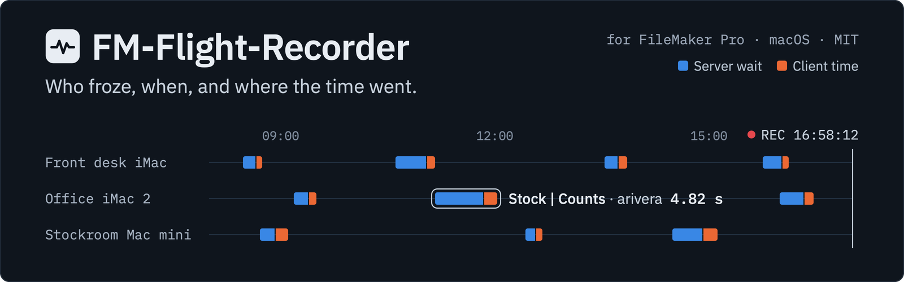
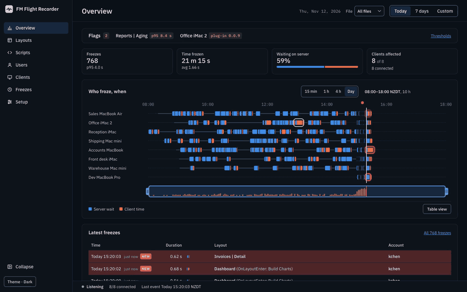

<p align="center"></p>

<p align="center">
  <a href="#status"></a>
  
  
  
  
  <a href="LICENSE"></a>
</p>

> **Warning:** This is a prototype. It is not ready for production. Data formats and options can change.

# FM Flight Recorder

FM Flight Recorder is a plug-in for FileMaker Pro on macOS.
It records each freeze of the FileMaker Pro client that is 250 ms or longer.

For each freeze, the plug-in records:

- The start time and the duration of the freeze.
- The file, the layout, the script, and the account before and after the freeze.
- The number of round trips to FileMaker Server during the freeze.
- The time that the client waited for FileMaker Server.

The companion server (`fr-server`) receives the events from the plug-ins on your LAN and shows them in a dashboard.

<p align="center"></p>

<p align="center"><em>The redesigned dashboard (PR #74) on synthetic demo data with eight simulated clients.</em></p>

## Status

This project is pre-alpha.

- The plug-in loads and records freezes in FileMaker Pro 26.0.3 on macOS.
- We did not test the plug-in with a file on FileMaker Server.
- We did not test the plug-in and the server together at a site.

## Quick start

You need macOS, FileMaker Pro 26.0.3, the Xcode command line tools, Rust, and the Claris FileMaker Plug-in SDK 26.0.3 in `sdk/`.
The full steps are in [Install the plug-in](https://github.com/solutionscay/fm-flight-recorder/wiki/Install-the-plug-in).

1. Build, test and install the plug-in. Quit FileMaker Pro first.

   ```sh
   cargo test --workspace
   scripts/build-plugin.sh
   scripts/install-plugin.sh
   ```

2. Build and start the companion server on a Mac on the LAN:

   ```sh
   scripts/build-server.sh
   dist/fr-server serve
   ```

3. Open `http://<server address>:8787/setup` and copy the startup script step. It has this form:

   ```
   FlightRecorder_Start ( "endpoint=http://192.168.1.10:8787; token=<event token>" )
   ```

## Saved options

The plug-in starts when FileMaker Pro starts. It uses the options of the last `FlightRecorder_Start` call that had an `endpoint=`:

- A `FlightRecorder_Start` call with `endpoint=` saves its options to `~/Library/Application Support/FlightRecorder/start-options` (mode 0600, because the file holds the token). Run it one time. The plug-in then sends after each start of FileMaker Pro.
- Without a saved file, the plug-in records to the local log only, and does not send.
- A call with no `endpoint=` does not change the saved file.
- A call with the same options as the running session keeps that session. It does not start a new session.
- To delete the saved options, run `FlightRecorder_Stop ( "forget" )`. The recorder stops. At the next start of FileMaker Pro, the plug-in records but does not send.

## Documentation

The documentation is in the [wiki](https://github.com/solutionscay/fm-flight-recorder/wiki):

- [Install the plug-in](https://github.com/solutionscay/fm-flight-recorder/wiki/Install-the-plug-in)
- [Try it in FileMaker](https://github.com/solutionscay/fm-flight-recorder/wiki/Try-it-in-FileMaker)
- [Plug-in functions](https://github.com/solutionscay/fm-flight-recorder/wiki/Plug-in-functions)
- [Companion server](https://github.com/solutionscay/fm-flight-recorder/wiki/Companion-server)
- [Dashboard](https://github.com/solutionscay/fm-flight-recorder/wiki/Dashboard)
- [Design](https://github.com/solutionscay/fm-flight-recorder/wiki/Design)
- [SDK notes](https://github.com/solutionscay/fm-flight-recorder/wiki/SDK-notes)
- [Troubleshooting](https://github.com/solutionscay/fm-flight-recorder/wiki/Troubleshooting)

The ingest API contract is in [docs/ingest-api.md](docs/ingest-api.md).

## License

MIT. See [LICENSE](LICENSE).
